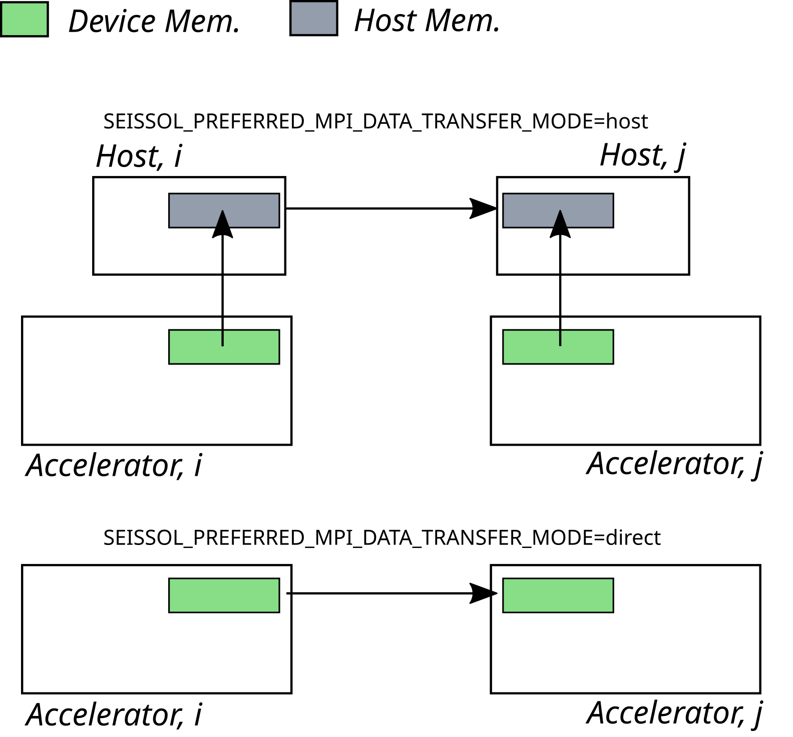

..
  SPDX-FileCopyrightText: 2021 SeisSol Group

  SPDX-License-Identifier: BSD-3-Clause
  SPDX-LicenseComments: Full text under /LICENSE and /LICENSES/

  SPDX-FileContributor: Author lists in /AUTHORS and /CITATION.cff

SeisSol with GPUs
=======================================

General
~~~~~~~

.. _gpu_process_pinning:

The current GPU version of SeisSol targets the latest NVIDIA, AMD, and Intel graphics cards. Therefore, you
need to have at least CUDA 11.8 or ROCm 6.0 installed in your environment. Moreover, for the best performance, make sure
that your installed MPI implementation is GPU-aware. If you are unsure, consult the documentation of the cluster you are using.

You can also utilize `UCX communication layer
<https://github.com/openucx/ucx>`_ if you need to manually configure CUDA-Aware MPI for a cluster or your local server
with an open-source MPI implementation e.g., OpenMPI.

GPU version of SeisSol follows *single rank/single GPU* strategy. Therefore,
if you want to run SeisSol on **M** nodes where each node is equipped with **N** GPUs then
make sure that you launch SeisSol with **M x N** MPI processes.

To achieve the most efficient CPU-to-GPU communication and vice versa you have
to pin your MPI processes to CPU cores which are the closest to the target
GPUs. This problem is also known as GPU affinity. Latest versions of workload
managers (e.g. SLURM) are aware of this problem and try to provide an
automatic, GPU-aware process pinning. Consider the following SLURM options:

- ``--ntasks-per-gpu``
- ``--gpu-bind``

You can also enforce good GPU affinity with rankfiles if your GPU cluster or local server
does not use a workload manager but is equipped with multiple GPUs per node.

Supported SeisSol features
~~~~~~~~~~~~~~~~~~~~~~~~~~

The SeisSol GPU version supports everything the SeisSol CPU version supports.

In some cases, the features are still considered "beta" due to limited testing so far;
see the following list:

- acoustic, elastic (isotropic, anisotropic), visco-elastic, and poroelastic wave propagation models (all stable)
- elastic-acoustic interaction (stable)
- fused simulations (beta)
- kinematic point sources (stable)
- dynamic rupture (stable; except TP in beta)
- off-fault plasticity (stable)

Time clustering
~~~~~~~~~~~~~~~

Local time-stepping poses additional challenges on GPUs compared on CPUs:
a time cluster that carries little work does not become cheap in proportion, because a launch costs
roughly the same regardless of how many elements it touches, and because a small cluster never
saturates the device. While these effects are also already visible on CPUs; they do not carry such a large effect.
The cost model that SeisSol uses to pick a clustering can be told about both effects through
*LtsCostLaunch* and *LtsCostFill*; see :ref:`the section on choosing the ladder automatically
<lts_lattice_search>`.
Both default to zero, which reproduces the CPU-oriented update counting, so they have to be measured
and set explicitly for the clustering to reflect GPU behavior.

Compilation
~~~~~~~~~~~

To start off, make sure that you already have GPU code generator installed on your system.
If you don't have then follow this :ref:`link <gemmforge_installation>`.

After that, get the latest version of SeisSol

.. code-block:: bash

   git clone --recurse-submodules https://github.com/SeisSol/SeisSol.git seissol-gpu

Compile SeisSol with (e.g.)

.. code-block:: bash

    mkdir -p seissol-gpu/build && cd seissol-gpu/build
    cmake -DDEVICE_BACKEND=cuda -DDEVICE_ARCH=sm_70 -DHOST_ARCH=skx \
    -DCMAKE_BUILD_TYPE=Release -DPRECISION=double ..
    make -j

The following two CMake options can be useful to improve performance:

* ``USE_GRAPH_CAPTURING``: enables CUDA, HIP, or SYCL (oneAPI) graphs. These are used to speed up the kernel execution for wave propagation equations.
* ``PREMULTIPLY_FLUX``: enables the pre-multiplying of flux matrices (it was disabled for CPUs to free up cache space). This usually results in a speedup for AMD and Nvidia GPUs. By default, it is switched on when compiling for an AMD or Nvidia GPU and switched off in all other cases.
* ``DEVICE_EXPERIMENTAL_EXPLICIT_KERNELS``: enables a hand-written kernel to speed up some internal, heavily memory-bound computations. Enabled for AMD and NVIDIA GPUs by default; but it works on all others as well.

.. _gpu-env:

Execution
~~~~~~~~~

The launching process of the GPU version of SeisSol is similar as the one of the CPU version.

.. code-block:: bash

    mpirun -n <M x N> ./SeisSol_dsm70_cuda_* ./parameters.par

The following device-specific environment variable is supported right now:

- ``SEISSOL_USM``

- ``SEISSOL_USM_MPI``

- ``SEISSOL_L2_COMPRESS``

- ``SEISSOL_TRANSFER_MODE``

- ``SEISSOL_DEVICE_LOOP_STATISTICS``

``SEISSOL_USM`` specifies if the data buffers are allocated using unified/managed (i.e. CPU-accessible) memory,
or GPU memory. It is off by default, also on systems whose GPU shares its memory with the CPU,
like the Grace Hopper and Grace Blackwell Superchips, or APUs like the MI300A:
the host then keeps a copy of the data, into which the outputs copy what they read, while the GPU works on its own.
On an APU, these copies take memory from the same pool as the GPU; ``SEISSOL_USM=1`` saves that memory.
With the outputs on a thread of their own, the data that changes keeps a copy for the host with ``SEISSOL_USM=1``
as well (see :ref:`gpu-time-stepping`).
Running clusters on the host (``SEISSOL_DEVICE_HOST_SWITCH``) needs ``SEISSOL_USM=1``.

``SEISSOL_USM_MPI`` specifies the allocation mode for the buffers that are also used for MPI transfer; off by default as well.
E.g. some MPI implementations, even if GPU-aware, will treat unified/managed memory buffers are CPU buffers
otherwise.

``SEISSOL_L2_COMPRESS`` enables L2 compression on those GPUs and frameworks where it is available.
Currently, that is only CUDA; we recommend to check the respective guides for availability
(generally, Hopper or newer should always support it; and Ampere slightly restricted).
Disabled by default, and currently requires ``SEISSOL_USM=0`` and ``SEISSOL_USM_MPI=0``.

``SEISSOL_DEVICE_LOOP_STATISTICS`` decides whether the work enqueued on the GPU gets timed: the loops of the clusters
for the loop statistics of the run summary (see :ref:`run-summary`), the replays of super-timesteps and the halo
exchange on device streams, all for the activity of the device (see :ref:`activity`). A pair of events goes around
each piece of work on its stream (with CUDA and HIP; with SYCL, where the Device library is built with
``ENABLE_PROFILING_MARKERS=ON`` or the device has profiling tags, as Intel GPUs with oneAPI; otherwise, the loops keep
the time it takes to enqueue them).
On by default; each timed loop costs two records of events, about 1 to 2 % of the run time of a small mesh.
``SEISSOL_DEVICE_LOOP_STATISTICS=0`` leaves the work on the GPU out of the statistics.

``SEISSOL_TRANSFER_MODE`` (or its alias ``SEISSOL_PREFERRED_MPI_DATA_TRANSFER_MODE``)
specifies how to exchange GPU buffers between processes.
The default value is ``direct`` which copies the data out of the GPU buffers directly.
In contrast, the ``host`` value means that the data will be copied to/from the host memory
before/after each send/receive operation.
That is especially useful, since some MPI implementations are not GPU-aware and do not support direct point-to-point
communication on device buffers.
As a (subpar) alternative, you can also try using ``SEISSOL_USM_MPI=1`` and ``direct`` to utilize unified/managed memory.

Four further values run the exchange on GPU streams: ``ccl`` (NCCL, RCCL or oneCCL),
``stream-mpi`` (MPI operations enqueued on a stream), ``shmem`` (NVSHMEM, ROCSHMEM or Intel SHMEM),
and ``actor-mpi`` (any MPI from the host, with the GPU streams waiting for it).
They are considered experimental, and all but the last one need to be enabled at build time;
see :ref:`gpu-time-stepping` for their requirements, and for the other ways of running the time stepping on GPUs.

